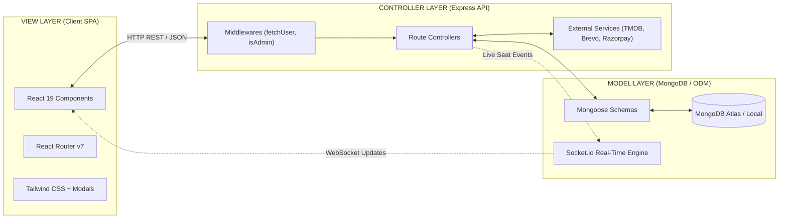
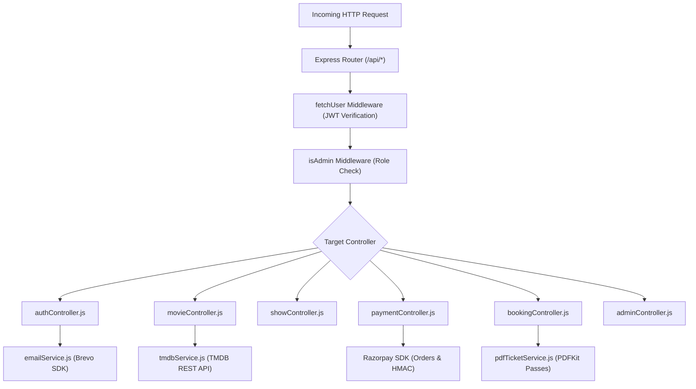
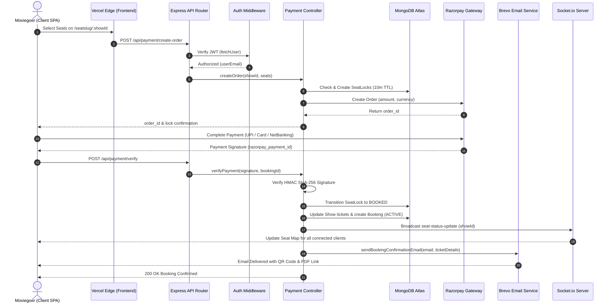

# 🏛️ System Architecture & MVC Implementation

This document provides a comprehensive technical overview of the **iMovies** architecture, illustrating the Model-View-Controller (MVC) design pattern, data flow, component hierarchy, and request lifecycle.

---

## 1. High-Level Architecture Overview

**iMovies** is architected as a modern, decoupled full-stack web application implementing the **Model-View-Controller (MVC)** architectural pattern:



- **Models**: Define data structure, validation rules, indexing, and persistence logic via Mongoose schemas.
- **Views**: Comprise the client-side React 19 Single Page Application (SPA), providing interactive UIs, dynamic forms, and consistent JSON API view contracts.
- **Controllers**: Coordinate application logic, handle HTTP requests, enforce Role-Based Access Control (RBAC), and communicate between Models and external third-party APIs.

---

## 2. Model Layer (Data & Persistence)

The Model layer is implemented using **Mongoose ODM** on top of MongoDB, leveraging unique compound indexes and Time-To-Live (TTL) expiration:

| Model File | Collection | Description & Key Responsibilities |
|---|---|---|
| [`userModel.js`](file:///C:/Users/jaina/.gemini/antigravity/scratch/iMovies/server/models/userModel.js) | `users` | Manages moviegoer identities, bcrypt-hashed passwords, role assignments (`user` / `admin`), and 6-digit OTP email verification states. |
| [`adminModel.js`](file:///C:/Users/jaina/.gemini/antigravity/scratch/iMovies/server/models/adminModel.js) | `admins` | Dedicated administrative credentials with elevated privileges for multiplex management and transaction refunds. |
| [`movieModel.js`](file:///C:/Users/jaina/.gemini/antigravity/scratch/iMovies/server/models/movieModel.js) | `movies` | Cached TMDB movie metadata including runtime, cast lists, trailers, backdrop posters, and genre arrays. |
| [`theatreModel.js`](file:///C:/Users/jaina/.gemini/antigravity/scratch/iMovies/server/models/theatreModel.js) | `theatres` | Defines physical auditoriums with 3-tier seating matrix templates (**Balcony**, **Middle**, **Lower**) and pricing rules. |
| [`showModel.js`](file:///C:/Users/jaina/.gemini/antigravity/scratch/iMovies/server/models/showModel.js) | `shows` | Represents scheduled cinema screenings. Contains the live seat availability state machine (`available` / `locked` / `booked`). |
| [`bookingModel.js`](file:///C:/Users/jaina/.gemini/antigravity/scratch/iMovies/server/models/bookingModel.js) | `bookings` | Complete booking transactions with chosen seats, Razorpay payment reference IDs, QR pass data, and ticket lifecycle states (`ACTIVE` / `CANCELLED` / `EXPIRED`). |
| [`seatLockModel.js`](file:///C:/Users/jaina/.gemini/antigravity/scratch/iMovies/server/models/seatLockModel.js) | `seatlocks` | Temporary concurrency lock holding seats during the 10-minute checkout window. Uses MongoDB TTL index for automatic expiry. |
| [`favoriteModel.js`](file:///C:/Users/jaina/.gemini/antigravity/scratch/iMovies/server/models/favoriteModel.js) | `favorites` | Stores bookmarked titles associated with user emails for rapid catalog access. |
| [`reviewModel.js`](file:///C:/Users/jaina/.gemini/antigravity/scratch/iMovies/server/models/reviewModel.js) | `reviews` | Community reviews, ratings (1 to 5 stars), and moviegoer feedback. |

---

## 3. Controller Layer (Business Logic & Services)

Controllers process client requests, enforce business rules, orchestrate transactions, and produce formatted JSON view responses:



### Controller Overview:
1. **`authController.js`**:
   - Manages user registration with mandatory 6-digit OTP email activation via Brevo.
   - Dual-tab login support with unified fallback detection for administrative accounts.
   - Self-healing startup and login bootstrapping for cloud databases (Render/Atlas).
   - Secure password recovery pipeline using 6-digit verification codes.
2. **`movieController.js`**:
   - Powers real-time TMDB dynamic movie discovery, Bollywood trending feeds, genre filters, and debounced fuzzy search endpoints.
3. **`showController.js`**:
   - Automates showtime scheduling, seat matrix generation, and strict chronological time sorting.
   - Integrates past-show validation to disable expired time slots for the current date.
4. **`paymentController.js`**:
   - Creates Razorpay payment orders.
   - Validates cryptographic HMAC SHA-256 signatures to confirm transactions.
   - Enforces atomic double-booking prevention by transitioning seat locks to permanent reservations.
   - Triggers asynchronous Brevo confirmation emails containing cinema details, live QR admission pass, and PDF links.
5. **`bookingController.js`**:
   - Manages ticket retrieval (`/my-tickets`), active vs expired status computation, user cancellations, seat releases, and PDF pass downloads.
6. **`adminController.js`**:
   - Aggregates platform financial metrics, audit logs, user account management, and 1-click Razorpay refund processing.

---

## 4. View Layer (Client SPA & JSON API Contracts)

The View layer consists of two synchronized layers:
1. **Frontend View Components (React 19 + Tailwind CSS)**:
   - Client-side routes configured with `react-router-dom` and React `lazy`/`Suspense`.
   - Reusable modal dialogs: [`OtpModal.jsx`](file:///C:/Users/jaina/.gemini/antigravity/scratch/iMovies/client/src/components/OtpModal.jsx), [`ForgotPasswordModal.jsx`](file:///C:/Users/jaina/.gemini/antigravity/scratch/iMovies/client/src/components/ForgotPasswordModal.jsx).
   - Dynamic SVG seat map with tier indicators and real-time Socket.io color state transitions.
2. **Standardized JSON API View Contracts**:
   All controller endpoints return structured, self-describing JSON payloads:
   ```json
   {
     "success": true,
     "message": "Action completed successfully.",
     "data": { ... }
   }
   ```
   Or on error:
   ```json
   {
     "success": false,
     "message": "Descriptive error message.",
     "error": "Internal error details"
   }
   ```

---

## 5. Request Lifecycle & End-to-End Sequence

The sequence diagram below illustrates the end-to-end request lifecycle when booking auditorium seats:



---

## 6. Concurrency Control & Double-Booking Prevention

To eliminate race conditions when multiple users attempt to reserve the same seat simultaneously:
1. **Compound Unique Index**: `SeatLock({ showId: 1, seatId: 1 })` strictly enforces that no two records can hold the same seat in an auditorium.
2. **TTL Index Expiration**: If a customer closes their browser during payment, MongoDB's native TTL index and the automated `cleanupService.js` background cron job automatically release the expired lock after 10 minutes.
3. **Atomic Verification**: Upon payment callback, `paymentController.js` verifies that conflicting locks have not occurred before committing permanent booking records.
