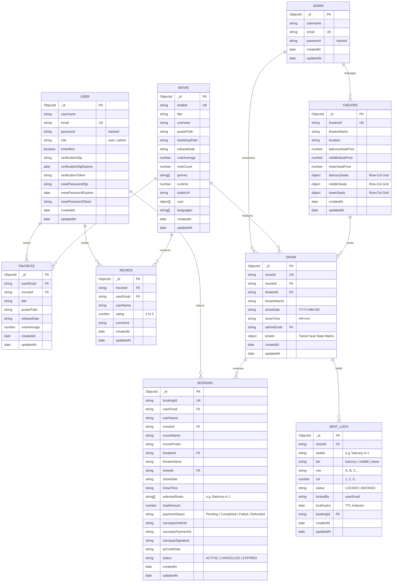

# 📊 Entity-Relationship (ER) Diagram

This document details the database schema architecture and relational data model implemented in **iMovies** using MongoDB and Mongoose ODM.

---

## 1. Schema Relationships Diagram

---

## 2. Relational Descriptions & Cardinality

| Parent Entity | Relation | Child Entity | Cardinality | Implementation Description |
|---|---|---|---|---|
| **User** | places | **Booking** | 1 : N | A registered moviegoer can place zero or multiple ticket bookings over time. |
| **User** | saves | **Favorite** | 1 : N | Users can bookmark favorite movies for quick discovery. |
| **User** | writes | **Review** | 1 : N | Verified users write ratings and reviews for listed titles. |
| **Theatre** | hosts | **Show** | 1 : N | A physical multiplex screen hosts multiple scheduled shows across dates and times. |
| **Movie** | features | **Show** | 1 : N | A film title can be scheduled across multiple auditoriums and showtimes. |
| **Show** | reserves | **Booking** | 1 : N | Each show manages ticket reservations. |
| **Show** | holds | **SeatLock** | 1 : N | Dynamic seat holding prevents concurrent collisions during checkout. |
| **Movie** | receives | **Review** | 1 : N | Aggregates community feedback, ratings, and testimonials. |

---

## 3. High-Performance Indexing & Constraints

1. **Unique Indexes**:
   - `User.email`: Ensures unique accounts per email address.
   - `Admin.email`: Unique administrator identity.
   - `Movie.tmdbId`: Prevents duplicate film indexing from external TMDB calls.
   - `Theatre.theatreId` & `Show.showId` & `Booking.bookingId`: Unique UUID identifiers.
2. **Compound & Concurrency Indexes**:
   - `SeatLock({ showId: 1, seatId: 1 })`: Unique compound index enforcing atomic seat lock allocation to eliminate race conditions.
3. **Time-To-Live (TTL) Auto-Expiring Indexes**:
   - `SeatLock.lockExpiry`: Automatically purged by MongoDB's background TTL monitor when temporary checkout reservations expire (default: 10 minutes).
