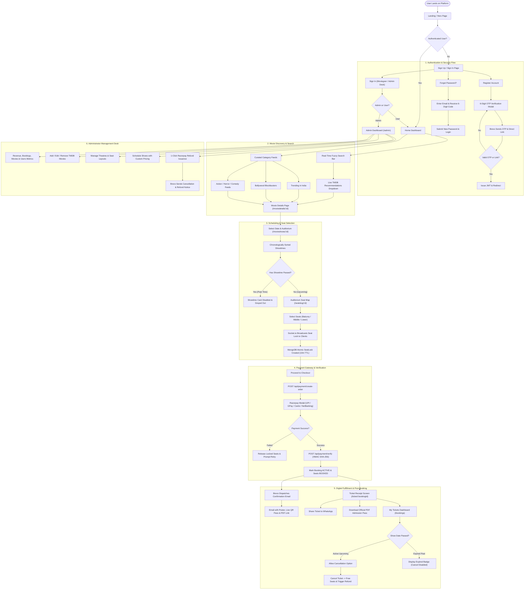

# 🗺️ User Flow Diagram

This document illustrates the end-to-end user journey across the **iMovies** platform, encompassing account authentication, dynamic movie discovery, seat selection, payment processing, ticket fulfillment, and admin workflows.

---

## 1. Complete End-to-End User Journey

---

## 2. Key User Journeys Explained

### A. Moviegoer Journey
1. **Browse**: Moviegoer searches titles via fuzzy search or explores live TMDB trending/Bollywood sections.
2. **Select Showtime**: Chronologically ordered showtimes filter out any past slots for the current date.
3. **Interactive Seating**: User selects seats across Balcony, Middle, or Lower tiers with live WebSocket sync.
4. **Instant Payment**: Seamless checkout via Razorpay with UPI/Cards and cryptographic verification.
5. **Admission Pass**: Instant receipt generated with live QR pass, downloadable PDF, and automated Brevo email.

### B. Admin Journey
1. **Login**: Seamless administrative authentication with automatic role detection.
2. **Audit & Monitor**: Real-time KPI financial metrics, ticket counts, and user management.
3. **Schedule Operations**: Adding multiplex screens, scheduling auditorium showtimes, and managing film metadata.
4. **Financial Control**: 1-click Razorpay transaction refunds with automatic seat release and email dispatch.
